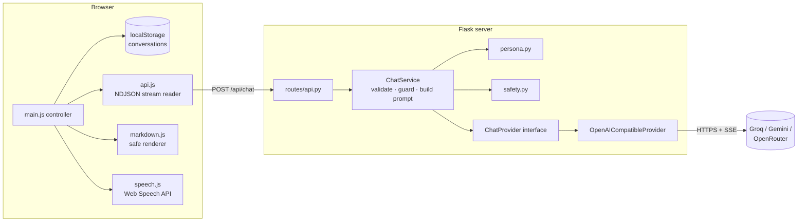

# 🙏 Ganesha Guide — Ganesh Chaturthi AI Chatbot

A warm, Ganesha-inspired AI companion. Share a prayer, a worry or a question and receive gentle, story-filled guidance — in English, Hindi, Marathi or Tamil.


---

## Overview

**Ganesha Guide** started as a festival project for Ganesh Chaturthi: a "guidance booth" where visitors could talk to a friendly AI modelled on the virtues of Lord Ganesha — wisdom, patience, new beginnings and the removal of obstacles.

The project went through two early prototypes:

| Version | What it did | Problems |
|---|---|---|
| **v1** | A command-line voice assistant (AssemblyAI speech-to-text, OpenAI, ElevenLabs voice) with a playful Lord Ganesha persona | API keys hardcoded in source, broken Flask endpoint, CLI-only |
| **v2** | A Flask "Ganesha Guidance Booth" with local Whisper speech recognition, OpenAI replies and Coqui TTS | App crashed on start (missing imports), heavy ML dependencies, single-turn only, README described a different (Gemini) setup |

This version merges the **personality of v1** with the **booth concept and safety rules of v2**, and rebuilds it as a clean, modular, tested web app that runs on a free AI API tier.

**Use cases**

- A festival kiosk or website where visitors share worries and receive kind, reflective replies.
- A storytelling companion for Ganesha lore (the broken tusk, Mushak the mouse, circling his parents…).
- A portfolio example of a provider-agnostic, streaming LLM chat application.

---

## Features

**Conversation**
- Multi-turn conversations with history sent as context (trimmed to a configurable window).
- **Streaming replies** — text appears as it is generated, with a typing indicator before the first token.
- **Stop generating** at any time; the partial reply is kept and marked "(stopped)".
- **New conversation** and **clear chat** actions; a conversation sidebar (drawer on mobile) with delete.
- Conversations persist in the browser's `localStorage` — nothing is stored on the server.
- Reply-language selector (auto / English / Hindi / Marathi / Tamil).
- Suggested starter prompts on the empty state.

**Messages**
- Safe Markdown rendering (bold, italics, lists, headings, quotes, links, inline code and fenced code blocks).
- Copy button for every message and for each code block.
- Message timestamps.
- **Read aloud** any reply (browser Speech Synthesis) and **voice input** via dictation (browser Speech Recognition, where supported) — keeping the "speak to Ganesha" spirit of the original voice booth without heavy server-side models.
- Multiline input (Shift + Enter), auto-growing text box, character counter near the limit.

**Reliability and errors**
- Friendly messages for rate limits (with a "try again in N s" countdown driven by `Retry-After`), timeouts, network failures, invalid keys and missing configuration.
- A setup banner when no API key is configured.
- Input validation on the server (roles, message length, history size, language, body size).
- A light safety guard that politely redirects political or deliberately disrespectful requests without calling the model.

**Interface**
- Festive saffron/marigold design with light and dark themes (follows the OS by default, toggle persisted).
- Responsive layout from phones to desktops, accessible labels, keyboard support, visible focus states and `prefers-reduced-motion` support.

---

## Screenshots

> Screenshots are not committed yet. To add them:
>
> 1. Run the app (see below) and capture the empty state, a conversation, dark mode and the mobile layout.
> 2. Save them in `docs/screenshots/` (for example `chat-light.png`, `chat-dark.png`, `mobile.png`).
> 3. Reference them here, e.g. ``.

---

## Technology Stack

| Layer | Technology |
|---|---|
| Language | Python 3.9+, JavaScript (ES modules), HTML, CSS |
| Backend | [Flask 3](https://flask.palletsprojects.com/) (application factory + blueprints) |
| HTTP client | [requests](https://requests.readthedocs.io/) (streaming Server-Sent Events) |
| Config | [python-dotenv](https://pypi.org/project/python-dotenv/) and environment variables |
| AI providers | [Groq](https://console.groq.com/docs/overview) (default), [Google Gemini](https://ai.google.dev/gemini-api/docs/openai), [OpenRouter](https://openrouter.ai/docs) — any OpenAI-compatible API |
| Frontend | Vanilla JS, no build step; Web Speech API for voice |
| Production server | [Gunicorn](https://gunicorn.org/) |
| Testing | pytest (backend), `node:test` (Markdown renderer) |
| Fonts | Inter, Yatra One (Google Fonts) |

---

## Project Architecture



### Folder structure

```
Ganesh-chatbot/
├── run.py                       # Dev entry point (python run.py)
├── requirements.txt             # Runtime dependencies
├── requirements-dev.txt         # + pytest
├── .env.example                 # Configuration template (copy to .env)
├── ganesha/
│   ├── __init__.py              # create_app() factory, error handlers, logging
│   ├── config.py                # Settings + provider presets from env vars
│   ├── routes/
│   │   ├── api.py               # /api/health, /api/config, /api/chat (streaming)
│   │   └── pages.py             # / (renders the UI)
│   ├── services/
│   │   ├── chat_service.py      # Request parsing/validation, prompt building
│   │   ├── persona.py           # Ganesha system prompt, greeting, languages
│   │   ├── safety.py            # Input sanitising + gentle topic redirects
│   │   └── llm/
│   │       ├── base.py          # ChatProvider interface, ChatMessage, ProviderError
│   │       └── openai_compatible.py  # HTTP + SSE client for OpenAI-style APIs
│   ├── templates/index.html     # Page shell
│   └── static/
│       ├── css/styles.css       # Design tokens, light/dark themes, layout
│       ├── img/favicon.svg
│       └── js/
│           ├── main.js          # App controller (state, events, chat flow)
│           ├── api.js           # Fetch + NDJSON streaming + friendly errors
│           ├── store.js         # Conversation persistence (localStorage)
│           ├── markdown.js      # Escape-first Markdown renderer
│           ├── speech.js        # Dictation and read-aloud
│           └── ui/              # messages, sidebar, theme, icons
└── tests/
    ├── conftest.py              # Fake provider + app fixtures
    ├── test_chat_api.py         # API behaviour, validation, errors, streaming
    ├── test_provider.py         # HTTP provider, SSE parsing, error mapping, config
    └── js/markdown.test.mjs     # Markdown renderer (XSS safety, formatting)
```

### Key modules

- **`services/llm/`** — the provider abstraction. The app depends only on `ChatProvider.stream_chat()`. Groq, Gemini and OpenRouter all speak the OpenAI wire format, so one small class covers them; a provider with a different API would be one new subclass registered in `create_provider()`.
- **`services/chat_service.py`** — turns an HTTP payload into a validated `ChatRequest`, applies the safety guard and assembles `[system prompt, history…, new message]`.
- **`routes/api.py`** — streams replies as newline-delimited JSON. It pulls the first token *before* starting the response so configuration, auth and rate-limit errors become normal HTTP errors instead of a broken stream.
- **`static/js/markdown.js`** — escapes all HTML first and then applies formatting; only `http(s)`/`mailto` links are allowed, so model output can never inject markup.

---

## Installation and Setup

### Prerequisites

- Python **3.9 or newer**
- A free API key from **one** provider (Groq is recommended)
- Optional: Node.js 18+ to run the JavaScript unit tests

### 1. Clone

```bash
git clone https://github.com/<your-username>/<repository>.git
cd <repository>/Ganesh-chatbot
```

### 2. Create a virtual environment and install dependencies

```bash
python3 -m venv .venv
source .venv/bin/activate          # Windows: .venv\Scripts\activate
pip install -r requirements.txt    # or requirements-dev.txt to also run tests
```

### 3. Configure the environment

```bash
cp .env.example .env
```

Open `.env` and set your key:

```ini
LLM_PROVIDER=groq
GROQ_API_KEY=your-key-here
```

| Provider | Get a key | Required settings |
|---|---|---|
| Groq (default) | <https://console.groq.com/keys> | `GROQ_API_KEY` (model defaults to `openai/gpt-oss-120b`; `qwen/qwen3.8-27b` and `openai/gpt-oss-20b` also work — see which models your key can use at <https://console.groq.com/docs/models>) |
| Google Gemini | <https://aistudio.google.com/apikey> | `LLM_PROVIDER=gemini`, `GEMINI_API_KEY`, `LLM_MODEL` (a current id from the [models page](https://ai.google.dev/gemini-api/docs/models)) |
| OpenRouter | <https://openrouter.ai/keys> | `LLM_PROVIDER=openrouter`, `OPENROUTER_API_KEY`, `LLM_MODEL` (any `:free` model) |
| Any OpenAI-compatible API | — | `LLM_PROVIDER=custom`, `LLM_BASE_URL`, `LLM_API_KEY`, `LLM_MODEL` |

The API key is only ever read by the server. It is never sent to the browser.

---

## Running the Application

### Development

```bash
python run.py
```

Open <http://127.0.0.1:5050>. (The default is 5050 because macOS AirPlay Receiver occupies port 5000.) Set `FLASK_DEBUG=1` in `.env` for auto-reload and debug pages (never in production).

### Production

```bash
gunicorn --bind 0.0.0.0:8000 --workers 2 --threads 4 "ganesha:create_app()"
```

Set the same environment variables in your hosting provider's settings instead of uploading a `.env` file. Threads are recommended because replies are streamed.

### Tests

```bash
pip install -r requirements-dev.txt
python -m pytest
node --test tests/js/markdown.test.mjs
```

---

## API Documentation

### External AI APIs

All three supported providers offer a free tier at the time of writing. **Limits change frequently — always check the official pages linked below.**

| Provider | Free tier (as documented) | Notes |
|---|---|---|
| **Groq** — default | Free plan with per-model limits on requests and tokens per minute/day, applied per organisation. Published example: `openai/gpt-oss-120b` at 30 requests/min and 1,000 requests/day. Your exact limits are shown on the limits page in the Groq console. | Very fast inference, OpenAI-compatible, no card needed. 131k-token context for the default `openai/gpt-oss-120b`. [Rate limits](https://console.groq.com/docs/rate-limits) · [Models](https://console.groq.com/docs/models) |
| **Google Gemini** | Free tier available; limits vary by model and are listed in AI Studio. | OpenAI-compatible endpoint at `https://generativelanguage.googleapis.com/v1beta/openai/`. Review the Gemini API terms for how free-tier data may be used. [Rate limits](https://ai.google.dev/gemini-api/docs/rate-limits) · [OpenAI compatibility](https://ai.google.dev/gemini-api/docs/openai) |
| **OpenRouter** | `:free` models: 20 requests/min; 50 requests/day (1,000/day after purchasing at least 10 credits). | Many models behind one API; free model availability changes. [Limits](https://openrouter.ai/docs/api-reference/limits) |

**Why Groq is the default:** it needs no payment method, has a usable daily quota for a personal or demo project, very low latency (important for a streaming chat) and a stable OpenAI-compatible API. Because of the provider abstraction, switching to Gemini or OpenRouter only means changing `.env`.

### Internal HTTP API

| Method | Path | Description |
|---|---|---|
| `GET` | `/api/health` | Liveness check → `{"status": "ok"}` |
| `GET` | `/api/config` | Greeting, languages, message limit, provider name/model and whether a key is configured |
| `POST` | `/api/chat` | Streams a reply |

`POST /api/chat` request:

```json
{
  "messages": [
    {"role": "user", "content": "I'm nervous about my exams"},
    {"role": "assistant", "content": "…"},
    {"role": "user", "content": "How do I start revising?"}
  ],
  "language": "hi"
}
```

Response (`application/x-ndjson`), one JSON object per line:

```json
{"type": "delta", "text": "नमस्ते"}
{"type": "delta", "text": ", मित्र!"}
{"type": "done"}
```

Errors before streaming starts return JSON with an HTTP status, e.g. `429 {"error": {"code": "rate_limited", "message": "…", "retryAfter": 12}}`. Error codes: `invalid_request` (400), `not_configured` (503), `rate_limited` (429), `timeout` (504), `auth`, `network`, `upstream`, `empty_reply` (502).

---

## Application Workflow

1. **Load** — the browser fetches `/api/config` (greeting, languages, whether a key is configured) and restores the most recent conversation from `localStorage`.
2. **Send** — the user's message is saved locally and the full conversation (user/assistant turns only) is posted to `/api/chat` with the chosen language.
3. **Validate and guard** — `parse_request` checks roles, lengths and language and trims history to `MAX_HISTORY_MESSAGES`. `safety.check_message` may return a gentle redirect without calling the model.
4. **Prompt** — `ChatService` prepends the Ganesha system prompt plus a language instruction.
5. **Generate** — `OpenAICompatibleProvider` calls `/chat/completions` with `stream: true` and parses the Server-Sent Events stream. HTTP errors, timeouts and dropped connections become typed `ProviderError`s.
6. **Stream** — the Flask route relays each chunk as an NDJSON line. The browser renders the growing Markdown once per animation frame.
7. **Finish** — the complete reply is stored in the conversation. On failure an inline notice offers a retry (with a countdown for rate limits).

---

## Future Improvements

- Server-side per-IP rate limiting (e.g. Flask-Limiter) for public deployments.
- Optional server-side speech-to-text/TTS for browsers without the Web Speech API (Firefox has no speech recognition).
- Export/import conversations as Markdown.
- Regenerate and edit-and-resend for the last message.
- A Dockerfile and one-click deploy configuration.
- End-to-end browser tests (Playwright) in CI.

---

## Contributing

Contributions are welcome.

1. Fork the repository and create a feature branch: `git checkout -b feature/my-change`.
2. Install dev dependencies (`pip install -r requirements-dev.txt`) and make your change.
3. Add or update tests and make sure `python -m pytest` and `node --test tests/js/markdown.test.mjs` pass.
4. Never commit `.env` or API keys.
5. Open a pull request describing what changed and why.

---

## License

No license file is included yet. All code in this folder is original and its dependencies (Flask — BSD-3-Clause, requests — Apache-2.0, python-dotenv — BSD-3-Clause, Gunicorn — MIT) are permissively licensed, so the **MIT License** is a good fit for a portfolio project. Add a `LICENSE` file with your name and year to apply it.

The Google Fonts used (Inter, Yatra One) are under the SIL Open Font License and are loaded from Google's CDN, not redistributed.

---

## Author

**Your Name**
- GitHub: [@shashank-legend](https://github.com/shashannk-legend)
- LinkedIn: [K Shashank Reddy](https://www.linkedin.com/in/shashank-reddy-k-903607332/)
- Email: harshashank.2005@gmail.com
